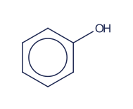
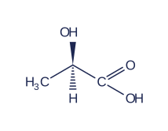
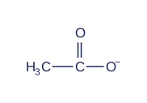

# rehype-chemfig

**Chemfig drawing syntax → accessible SVG in Markdown and HTML. No TeX installation.**

A TypeScript renderer for a **documented subset** of [Chemfig](https://ctan.org/pkg/chemfig), with plugins for [rehype](https://github.com/rehypejs/rehype) and [remark](https://github.com/remarkjs/remark). Write a molecule in a code fence; get a crisp, selectable SVG figure in your document.


[Quick start](#quick-start) · [Examples](#examples) · [Options](#options) · [Supported syntax](#supported-syntax) · [Development](#development)

- **Local and synchronous.** No TeX, remote rendering service, CDN, or browser needed to generate SVG.
- **Real document nodes.** Emits HAST SVG elements, not injected raw HTML. No `allowDangerousHtml` required.
- **Block and inline.** Fenced figures, inline structures, optional remark captions, and accessible SVG titles.
- **Style with CSS.** Bonds and labels inherit `currentColor`; the optional stylesheet handles sizing and alignment.
- **Use only what you need.** ESM, TypeScript declarations, standalone rendering APIs, and browser-compatible core.

> This is an independent implementation of a Chemfig **subset**, not a TeX engine or a chemical toolkit. It does not validate valence, infer hydrogens, interpret SMILES, or promise pixel-identical TeX output. [Check the boundaries before adopting it.](#unsupported-and-intentionally-stricter-cases)

## Installation

The intended package name is **`rehype-chemfig`**, following the unified ecosystem's `rehype-*` convention. It includes the remark plugin too. This repository is not published to npm yet. Once published:

```sh
bun add rehype-chemfig unified remark-parse remark-rehype rehype-stringify
```

For local use now, run `bun install` and `bun pm pack` in this repository, then `bun add /path/to/rehype-chemfig-0.1.0.tgz` in your application. Packing builds the package automatically. Consumers can use any package manager; **Bun is used to develop this repository**, not required by the published renderer. Node.js 20+ and modern browsers are supported.

## Quick start

````js
import { unified } from 'unified';
import remarkParse from 'remark-parse';
import remarkRehype from 'remark-rehype';
import rehypeStringify from 'rehype-stringify';
import rehypeChemfig from 'rehype-chemfig';

const markdown = '```chemfig\n*6(-=-=-=)\n```';

const file = await unified()
  .use(remarkParse)
  .use(remarkRehype)
  .use(rehypeChemfig)
  .use(rehypeStringify)
  .process(markdown);

console.log(String(file)); // <figure …><svg …>…</svg></figure>
````

Add `import 'rehype-chemfig/styles.css'` to your application's stylesheet entry if your bundler supports CSS imports. No browser JavaScript is needed to display the generated figures.

## Examples

All images below are generated by this project's renderer. Click a structure to open its standalone SVG.

|                                      Aromatic ring                                      |                                            Stereochemistry                                             |                                       Charged group                                        |
| :-------------------------------------------------------------------------------------: | :----------------------------------------------------------------------------------------------------: | :----------------------------------------------------------------------------------------: |
| [](assets/examples/phenol.svg) | [](assets/examples/lactic-acid.svg) | [](assets/examples/acetate.svg) |
|                              **Phenol** · aromatic circle                               |                                **Lactic acid** · solid / hashed wedges                                 |                          **Acetate** · subscripts / superscripts                           |

**[Browse all 10 examples with copyable Markdown](docs/examples.md)**, including aspirin, caffeine, benzene, ethanol, glycine, acetonitrile, and pyridine.

Try the editable drawing bench locally:

```sh
bun install
bun run demo  # http://localhost:4173; override with PORT=…
```

Choose an example, edit its source, and download the result as standalone SVG. Initial figures are built with the remark plugin; edits run the same pipeline in the browser, entirely locally.

## Markdown syntax

Use a `chemfig` fence. The content is either the molecule body or a single `\chemfig{…}` wrapper. An optional **plain-text fence meta string** becomes a visible caption and accessible name:

````md
```chemfig Acetate
H_3C-C(=[:90]O)-O^{-}
```

An alcohol group, `chemfig: H_3C-CH_2-OH`, within a paragraph.

```chemfig Benzene
\chemfig{*6(-=-=-=)}
```
````

Inline syntax is deliberately an **inline code span starting with `chemfig:`**. This preserves backslashes, braces, `<`, `>`, `*`, and `_` before Markdown can interpret them. Bare `\chemfig{…}` in prose and math delimiters are **not** recognized. Ordinary code remains ordinary code. Set `inline: false` to disable inline rendering.

## With rehype / HTML

The default export is `rehypeChemfig`. As shown in the [quick start](#quick-start), place it **after `remarkRehype` and before syntax highlighting**. Already-highlighted code with element children is deliberately left untouched.

It also works on existing HTML with `rehype-parse`:

```js
import { unified } from 'unified';
import rehypeParse from 'rehype-parse';
import rehypeStringify from 'rehype-stringify';
import rehypeChemfig from 'rehype-chemfig';

const file = await unified()
  .use(rehypeParse, { fragment: true })
  .use(rehypeChemfig)
  .use(rehypeStringify)
  .process('<pre><code class="language-chemfig">*6(-=-=-=)</code></pre>');
```

In HTML source, use `&lt;` for `<` wedge tokens. The plugin reads decoded text nodes. It only replaces `<pre>` containing one `language-chemfig` code element, and explicitly marked inline code; unrelated code is not interpreted.

## With remark and captions

Use the remark plugin **before `remarkRehype`** when you want fence captions preserved:

````js
import { unified } from 'unified';
import remarkParse from 'remark-parse';
import remarkRehype from 'remark-rehype';
import rehypeStringify from 'rehype-stringify';
import { remarkChemfig } from 'rehype-chemfig';

const markdown = '```chemfig Benzene\n*6(-=-=-=)\n```';

const file = await unified()
  .use(remarkParse)
  .use(remarkChemfig, { errorMode: 'throw' })
  .use(remarkRehype)
  .use(rehypeStringify)
  .process(markdown);

console.log(String(file));
````

The remark plugin replaces matching code nodes with custom `chemfig` mdast nodes carrying standard `data.hName`, `data.hProperties`, and `data.hChildren`. `remark-rehype` handles them without custom handlers or `allowDangerousHtml`. Block figures become `<figure>` and inline drawings become `<span>`, each containing a real `<svg role="img">` with `<title>` and an accessible name.

Subpath imports are also available:

```js
import remarkChemfig from 'rehype-chemfig/remark';
import rehypeChemfig from 'rehype-chemfig/rehype';
```

Choose **either** plugin. Both use the same renderer, and using both is harmless: generated figures are not processed again. Unlike the remark path, the rehype path cannot recover fence captions discarded by `remark-rehype`; use the remark plugin if you need fence captions, or add your own surrounding caption HTML.

### Styles

```js
import 'rehype-chemfig/styles.css';
```

The optional stylesheet supplies responsive sizing and block/inline alignment. SVG bonds and labels use `currentColor`, so figures inherit your text color and work on dark backgrounds. Without the stylesheet they still render at their intrinsic SVG dimensions. Use `.chemfig-display`, `.chemfig-inline`, `.chemfig-svg`, and `.chemfig-error` to style the surrounding document. The SVG uses Arial/Helvetica fallbacks for predictable, browser-independent width estimates.

### Untrusted Markdown and sanitizers

Input labels and captions become **text nodes**, never markup. The renderer cannot execute TeX, run shell commands, emit scripts/foreignObject/links, or pass arbitrary TikZ attributes through to SVG. Unknown commands and styles are errors.

This does not sanitize the **rest of your document**. For untrusted Markdown, use the **rehype path after sanitization**:

```js
import rehypeSanitize from 'rehype-sanitize';
import rehypeChemfig from 'rehype-chemfig';

unified()
  .use(remarkParse)
  .use(remarkRehype)
  .use(rehypeSanitize) // sanitize untrusted document first
  .use(rehypeChemfig) // then generate trusted SVG nodes from code text
  .use(rehypeStringify);
```

The default sanitizer schema removes SVG if you sanitize **after** rendering. If that order is required, configure and audit a schema allowing the specific generated SVG elements/attributes. Do not broadly enable arbitrary SVG or raw HTML.

## Reusable APIs

```js
import {
  parseChemfig,
  layoutChemfig,
  renderChemfig,
  layoutToSvg,
  ChemfigError,
} from 'rehype-chemfig/core';

const result = renderChemfig('H_3C-C(=[:90]O)-OH', {
  title: 'Acetic acid',
  bondLength: 42,
});

result.tree; // HAST Element: <svg> and real SVG children
result.svg; // escaped, standalone SVG string
result.syntax; // typed drawing AST; source ranges use original source offsets
result.layout; // positioned typographic groups, bonds, rings, and viewBox

const syntax = parseChemfig('*6(-=-=-=)');
const layout = layoutChemfig(syntax, { bondLength: 48 });
const svgNode = layoutToSvg(layout, 'Benzene');
```

Pass ASTs produced by `parseChemfig` to `layoutChemfig`, and layouts produced by `layoutChemfig` to `layoutToSvg`; these APIs do not validate arbitrary caller-constructed objects. Layout coordinates are SVG units (positive y points down). `LayoutBond.departure`/`arrival` are **1-based typographic subatom indices**, while `from`/`to` are **0-based layout group IDs**. Layout is a drawing graph, not a chemically normalized molecular graph. Fused-ring instructions can produce overlapping bonds.

### Options

Both plugins accept the renderer options plus `inline` and `errorMode`:

| Option        | Default            | Meaning                                                                           |
| ------------- | ------------------ | --------------------------------------------------------------------------------- |
| `bondLength`  | `42`               | Distance between connected typographic atom centers, not visible line length      |
| `fontSize`    | `17`               | Atom label size in SVG units                                                      |
| `strokeWidth` | `1.5`              | Bond stroke width                                                                 |
| `bondSpacing` | `4`                | Multiple-bond spacing; also determines wedge width                                |
| `padding`     | `12`               | Extra whitespace around geometry (stroke clearance is always added)               |
| `title`       | source description | Accessible name; a remark fence caption takes precedence                          |
| `inline`      | `true`             | Recognize `chemfig:` inline code (plugins only)                                   |
| `errorMode`   | `'render'`         | `'render'` preserves source with a visible diagnostic; `'throw'` fails processing |
| `limits`      | see below          | Per-structure resource limits                                                     |

Dimensions must be finite and at most 500; `padding` can be zero, other dimensions must be at least 0.1. Options are JavaScript renderer settings, **not** support for the outer TeX `\chemfig[key=value]` argument.

The core APIs always throw `ChemfigError` for invalid/unsupported source, with `code`, zero-based `offset`, and 1-based `line`/`column` relative to the original Chemfig source. Codes are `SYNTAX`, `UNSUPPORTED`, `LIMIT`, `OPTIONS`, and `GEOMETRY`. Plugin `'render'` mode adds a nonfatal `VFile` message with `source: 'chemfig'`, `ruleId` set to that code, and the original `ChemfigError` as `cause`. The message location identifies the enclosing Markdown/HTML code node; the cause contains the position **within the Chemfig source**. Code is preserved as escaped text, not a partial chemical drawing.

### Limits

```js
{ limits: { maxLength: 20_000, maxDepth: 32, maxAtoms: 1_000, maxBonds: 2_000 } }
```

These are the defaults. Hard maxima are 200,000 UTF-16 code units, 64 nesting levels, 10,000 groups, and 20,000 bonds. Limits must be positive integers. Ring sizes are 3–24; length multipliers are 0.05–10. Numeric fields accept decimal literals, not expressions or TeX evaluation. Parsing counts coincident fused-ring vertices conservatively; the layout may merge matching skeletal vertices afterward. There is no process-wide cache or mutable renderer state.

## Supported syntax

The reference is the [official Chemfig v1.82 manual](https://mirrors.ctan.org/macros/generic/chemfig/chemfig-en.pdf), especially Part II §§2–13 and Part III §4. See also [`CHEMFIG-COMPATIBILITY-NOTES.md`](CHEMFIG-COMPATIBILITY-NOTES.md) for independent research and canonical geometry fixtures.

| Feature                      | Examples / behavior                                                                                                                                                                |
| ---------------------------- | ---------------------------------------------------------------------------------------------------------------------------------------------------------------------------------- |
| Single, double, triple bonds | `A-B`, `A=B`, `A~B` (Chemfig uses `~`, **not** `#`, for triple bonds)                                                                                                              |
| All six Cram bonds           | `>`, `<`, `>:`, `<:`, `>\|`, `<\|`: solid, hashed, hollow. `A>B` is **wide at A**, narrow at B; `<` reverses it.                                                                   |
| Shifted double bonds         | `=^` puts the secondary line to the left of drawing direction; `=_` puts it right                                                                                                  |
| Empty skeletal vertices      | `-[:30]-[:-30]-[:30]`                                                                                                                                                              |
| Predefined angles            | `[1]` = absolute 45°, `[2]` = 90°, negative integers allowed                                                                                                                       |
| Absolute / relative angles   | `[:30]`, `[::60]`; positive is counterclockwise                                                                                                                                    |
| Length multipliers           | `-[,1.5]` or `-[:30,0.7]`                                                                                                                                                          |
| Scoped defaults              | Leading `[:20,1.5]` on the molecule or a branch; omitted fields inherit defaults                                                                                                   |
| Group attachment             | `ABCD-[:75,,2,3]EFG` connects B to G; 1-based indices                                                                                                                              |
| Nested branches              | `A-B(-[2]O)(-[6]OH)-C`; branches restore the attachment and incoming direction                                                                                                     |
| Regular rings                | `*6(-=-=-=)`, `A-B*5(-----)`; 3–24 sides, attachment vertex reused                                                                                                                 |
| Incomplete rings             | `*5(---)` draws **only** three sides, never an invented closure                                                                                                                    |
| Connected / nested rings     | `*6(--(-*5(-----))----)` and `*6(--*5(----)----)`                                                                                                                                  |
| Aromatic circles             | `**6(------)`; complete perimeter required; no automatic aromaticity perception                                                                                                    |
| Ring substituents            | `*6(-(-OH)-----)`; unspecified branch direction is the outward vertex bisector                                                                                                     |
| Subscripts / superscripts    | `H_3C`, `NH_{4}^{+}`, `O^{-}`, `R^{δ+}`; scripts remain text, not bond tokens                                                                                                      |
| Grouped labels               | `{(CH_3)_3}` protects structural characters and suppresses uppercase splitting                                                                                                     |
| Explicit atom splitting      | `C\|{(CH_3)_3}` (literal `\|` in this table denotes the `                                                                                                                          | ` character, **without** a backslash) |
| Distant bonds / hooks        | `A?-[:30]B-C?`, named `?[a]`; subsequent occurrences connect to the first. Optional bond type is 1–9 or a braced bond token, e.g. `?[a,{=}]`. Single-typographic-atom labels only. |
| Invisible bonds              | `A-[,,,,draw=none]B`; geometry advances without a stroke                                                                                                                           |
| Whitespace / comments        | Whitespace is ignored; `%` comments run to the next newline                                                                                                                        |
| Wrapper                      | Bare body or one `\chemfig{body}`; **no outer settings argument**                                                                                                                  |

Small label-command allowlist: `\mathrm{…}`, `\mathsf{…}`, `\textrm{…}`, `\text{…}` (all use the renderer's one upright font; whitespace is still ignored), plus `\oplus`, `\ominus`, `\cdot`, `\bullet`, `\alpha`, `\beta`, `\gamma`, `\delta`, `\Delta`, `\pi`, `\prime`, `\circ`, `\pm`, `\times`. Escaped `{`, `}`, `_`, `%`, `#`, `&`, and space become literal label text. Unicode is accepted directly. This is not general mathematical typesetting. Digits are only subscripts if written as subscripts: `CH3` does **not** become `CH_3`.

### Important angle rules

- In `A-[1]B-C-[::30]D`, the bond angles are **45°, 0°, 30°**, not 45°, 45°, 75°. An omitted angle uses the scoped default, not the preceding bond.
- A leading branch default like `([::-30]-X-Y)` resolves relative to the incoming bond **once**, then uses that direction for both branch bonds. Individual overrides do not mutate the default.
- `*6(------)` starts with a −30° side. The final side descends vertically to the attachment. Leading `[:30]` rotates the standalone ring by 30°.
- After an incoming bond at θ, an n-ring starts at θ − 90° + 180°/n. It is not laid out like a standalone ring.
- Ring double bonds default to an inward secondary line. Fused rings align their shared side; they are not automatically optimized or chemically normalized.

### Unsupported and intentionally stricter cases

Unsupported constructs are diagnosed, not silently approximated:

- Arbitrary TeX macros, math layout, macro expansion, `\definesubmol` / `!` aliases, `\charge` / Lewis notation, `\chemabove` / `\chembelow`, `\phantom`, `\chemname`, polymer delimiters, node references (`@`), `\chemmove`, reaction schemes/arrows, TeX preambles, and outer `\chemfig[…]` settings.
- TikZ styling/decorations, custom bond shortening (`#`, `\#`, `\CFhash`), arbitrary color/style strings; only `draw=none` in the fifth bond field is accepted. Use CSS `color` for the entire structure.
- Aromatic arc options (`**[30,330]…`), incomplete aromatic perimeters, nested scripts, custom angle increments, zero/negative length multipliers.
- Ring perimeter angle/length overrides and defaults inside ring parentheses. Upstream can ignore perimeter overrides; this renderer rejects them to avoid implying they changed the polygon.
- Excess ring perimeter bonds are errors instead of upstream's silent truncation. A closing ring bond cannot introduce a label. Unpaired hooks and self-hooks are errors.

Text widths and label clipping are deterministic **estimates**, not browser-measured or TeX metrics. Long groups, dense fused systems, or very short bonds can overlap; a stroke is omitted when label clearance consumes its length. Use clearer groups, explicit attachment indices, length multipliers, or a larger `bondLength`. There is no automatic collision avoidance. Schematics requiring the full TeX/TikZ feature set should use the original Chemfig package.

## Development

Use **Bun 1.4.2** (pinned in `package.json`). Commit `bun.lock` when changing dependencies; do not generate an npm lockfile.

```sh
bun install --frozen-lockfile
bun run check           # lint, format, types, tests, example freshness, build, demo
bun run demo            # editable drawing bench on localhost:4173
```

Individual tasks:

```sh
bun run lint            # Oxlint; warnings fail the check
bun run lint:fix        # apply safe lint fixes
bun run format          # format with Oxfmt
bun run format:check    # check formatting without changes
bun run typecheck
bun test
bun run build           # ESM + declarations + optional CSS in dist/
bun run examples:build  # regenerate committed SVG images and docs/examples.md
bun run examples:check  # fail if generated examples are stale
bun run demo:build      # build the package and browser demo in demo/public/
bun pm pack             # build and create the distributable tarball
```

Oxlint checks the source, scripts, demo, and tests. Oxfmt formats code, JSON, HTML, CSS, and Markdown; build output and generated examples are excluded. `demo/examples.ts` is the source of truth for the interactive examples, standalone SVGs, README contact sheet, and [example gallery](docs/examples.md). After changing the renderer or examples, regenerate images and run the full check.

Tests cover canonical angle/ring geometry, grouping and attachment, stereochemical orientation, Unicode/scripts, malformed and unsupported source, bounded input, escaping, HAST structure, remark/rehype integration, errors, sanitizer order, deterministic server rendering, and every gallery example through all three rendering APIs. The demo also bundles the same code for the browser.

## License and acknowledgements

MIT licensed. Chemfig syntax and reference examples originate with Christian Tellechea's Chemfig documentation; this implementation does not bundle Chemfig/TeX code. Created in [T3 Code](https://t3.codes).
