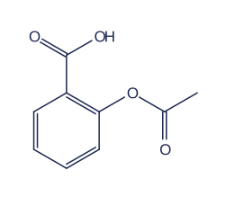
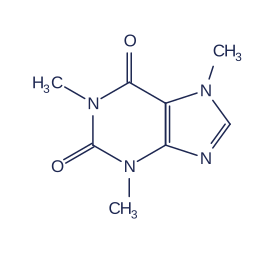
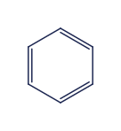
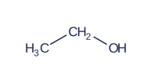
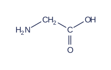
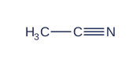
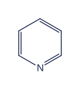

# Example gallery

[Back to the README](../README.md)

These images are generated by the project's SVG renderer from the same examples used in the interactive demo. No TeX or external rendering service is involved.

Use a molecule body in a `chemfig` fence, an inline `chemfig:` code span, or `renderChemfig(source)`. Captions after the opening fence are supported by the **remark** plugin; the rehype plugin renders the structure but cannot recover captions discarded during Markdown-to-HTML conversion.

Regenerate this page and its images with `bun run examples:build`. Edit `demo/examples.ts`, not the generated files.

## Aspirin



An aromatic scaffold with two branched functional groups.

````md
```chemfig Aspirin
*6(-=-(-O-[::-60](=[::-60]O)-[::+60])=(-(=[::+60]O)-[::-60]OH)-=)
```
````

## Caffeine



Nested rings, heteroatoms, and methyl groups in one drawing.

````md
```chemfig Caffeine
*6((=O)-N(-CH_3)-*5(-N=-N(-CH_3)-=)--(=O)-N(-H_3C)-)
```
````

## Lactic acid


Solid and hashed wedges preserve the direction written in the source.

````md
```chemfig Lactic acid
H_3C-[:30](<[:90]OH)(<:[:-90]H)-[:-30]C(=[:30]O)-[:-30]OH
```
````

## Phenol


A complete six-membered ring with an aromatic circle.

````md
```chemfig Phenol
**6(---(-OH)---)
```
````

## Acetate


Explicit subscripts, a carbonyl branch, and a superscript charge.

````md
```chemfig Acetate
H_3C-C(=[:90]O)-O^{-}
```
````

## Benzene



A skeletal ring with alternating double bonds drawn on the inside.

````md
```chemfig Benzene
*6(-=-=-=)
```
````

## Ethanol



A short chain with explicit hydrogen labels and alternating bond angles.

````md
```chemfig Ethanol
H_3C-[:30]CH_2-[:-30]OH
```
````

## Glycine



An amino acid drawn with an amine, a methylene group, and a carboxyl group.

````md
```chemfig Glycine
H_2N-[:30]CH_2-[:-30]C(=[:-90]O)-[:30]OH
```
````

## Acetonitrile



Chemfig uses a tilde for a triple bond, not a hash.

````md
```chemfig Acetonitrile
H_3C-C~N
```
````

## Pyridine



A six-membered aromatic ring with an explicitly labeled nitrogen.

````md
```chemfig Pyridine
*6(-N=-=-=)
```
````
